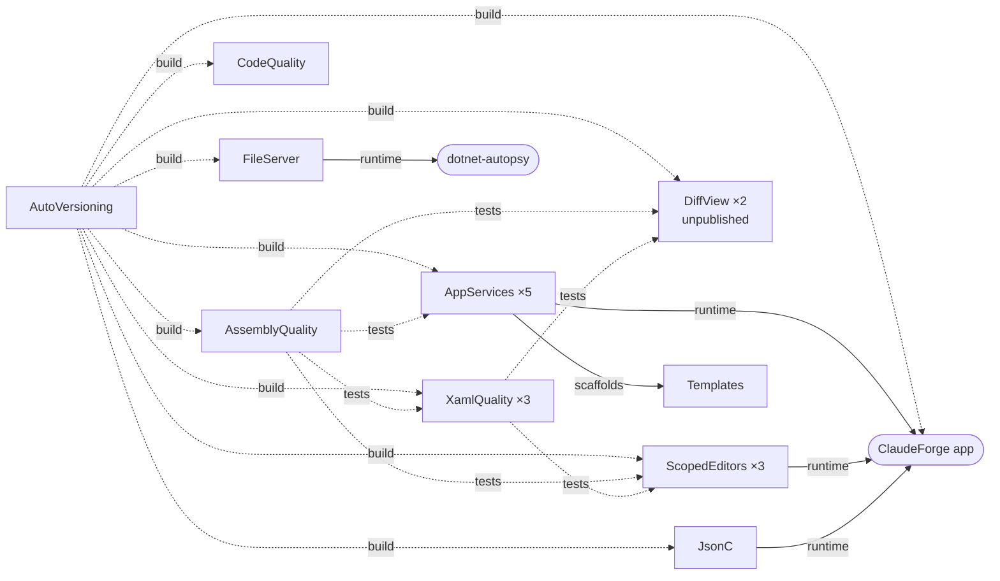

# Package consolidation — catalog and candidate groupings

Measured on 2026-10-20 from the default branch of every public, non-fork `JanusMael` repository and
from nuget.org's own API, not recalled. The groupings it proposed were settled on 2026-10-20; the
decisions are at the end.

## Catalog

### Repositories that publish to nuget.org

| Repository | Package ids | Kind | Latest on nuget.org | Downloads |
|---|---|---|---|---|
| `Bennewitz.Ninja.AssemblyQuality` | `Bennewitz.Ninja.AssemblyQuality` | library | 2026.3.929 | 956 |
| `Bennewitz.Ninja.XamlQuality` | `Bennewitz.Ninja.XamlQuality` | library | 2026.4.1014 | 1,730 |
| | `Bennewitz.Ninja.XamlQuality.ThemeAudit` | dotnet tool | 2026.4.1014 | 331 |
| | `Bennewitz.Ninja.XamlQuality.ThemeRuntime` | library | 2026.4.1014 | 0 |
| `Bennewitz.Ninja.CodeQuality` | `Bennewitz.Ninja.CodeQuality` | Roslyn analyzer (netstandard2.0) | 2026.3.928 | 79 |
| `Bennewitz.Ninja.AppServices` | `.AppServices`, `.Abstractions`, `.Logging`, `.Avalonia`, `.EntryPoint` | libraries, one version | 2026.4.1001 | ~1,100 each; `.EntryPoint` 0 |
| `Bennewitz.Ninja.ScopedEditors` | `.Abstractions`, `.ViewModels`, `.Avalonia` | libraries, one version | 2026.3.924 | ~1,100 each |
| `Bennewitz.Ninja.JsonC` | `Bennewitz.Ninja.JsonC` | library | 2026.3.926 | 128 |
| `Bennewitz.Ninja.AutoVersioning` | `Bennewitz.Ninja.AutoVersioning` | source generator (netstandard2.0) | 2026.3.928 | **21,587** |
| `Bennewitz.Ninja.Templates` | `Bennewitz.Ninja.Templates` | `dotnet new` templates | 2026.3.1001 | 257 |
| `Bennewitz.Ninja.FileServer` | `Bennewitz.Ninja.FileServer` | ASP.NET Core Razor library | 2026.9.23 | 510 |
| `chisel` | `Bennewitz.Ninja.Chisel` | dotnet tool | 2026.3.819 | 281 |
| `KubernetesClient.StrategicPatch` | `KubernetesClient.StrategicPatch` | library | 2026.2.501 | 232 |

### Repositories with packable ids that are not on nuget.org

| Repository | Ids | Where they go |
|---|---|---|
| `Bennewitz.Ninja.DiffView` | `Bennewitz.Ninja.DiffView.Core`, `Bennewitz.Ninja.DiffView.Avalonia` | Nowhere yet. No tag has been pushed |
| `ClaudeForge` | `AgentForge.Abstractions`, `.Artifacts`, `.Core`, `.Sdk`, `.Avalonia.Shell` | GitHub Packages, privately, from `release-packages.yml` on `packages-v*` tags |

⛔ **`AgentForge.Abstractions` and `AgentForge.Core` already exist on nuget.org, owned by
`subhajitlabs`.** Those ids can never be published there by this account. If `AgentForge.*` is ever
made public, it needs a new name first.

### Repositories with no NuGet package

`ClaudeForge` (the application itself), `ObexNet` (a GitHub Release executable), `dotnet-autopsy`,
`Git-ArchiveBranchDiffs`, and the forks `winget-pkgs`, `UniGetUI`, `fable-method` and
`fdroid_shizuku_privileged_extension`.

## Names and trusted-publishing policies

All 19 published ids have the same nuget.org owner, `JanusMael`. 18 sit under the reserved
`Bennewitz.Ninja` prefix and show the verified badge. `KubernetesClient.StrategicPatch` does not,
and it never can, because that prefix belongs to the Kubernetes client's owners.

⭐ **A name difference calls for a separate glob pattern, not a separate policy.** A policy carries
any number of patterns, and an exact id outside the prefix is allowed as one of them. A second
policy is needed only when a different account or organization owns the policy. No id has a
different owner today.

⛔ **Two policies must never match the same repository, workflow file and environment.** nuget.org
uses one matching policy per token exchange. The other policy's ids are rejected with a 403 after the
first ids have already been published permanently. If a merged repository ever needs two policies,
put them on different workflow files or different `environment:` values.

⚠ **Every policy is tied to its repository.** Moving an id into another repository means a policy
for the new repository. The id, its history and its owner stay the same. Whether a policy follows a
*renamed* repository, matching by its id, or stops at the old name is not established here, which is
why the grown repository's policy is edited or replaced and never duplicated.

## How the packages depend on each other

Two facts shape the groupings below:

- **AutoVersioning is a build dependency of nearly every repository**, so whichever repository holds
  it has to build with a published copy of itself.
- **AssemblyQuality and XamlQuality are test-time gates for four of the other repositories.** They
  are the family's shared tooling, not just packages that happen to sit next to each other.

## Candidate groupings

### A · Quality — recommended

| | |
|---|---|
| **Members** | AssemblyQuality, XamlQuality (3 ids), CodeQuality: **5 ids** |
| **Policy patterns** | `Bennewitz.Ninja.AssemblyQuality`, `Bennewitz.Ninja.XamlQuality*`, `Bennewitz.Ninja.CodeQuality` |
| **Why they belong together** | They are one product shown three ways: metadata, markup and source. CodeQuality and AssemblyQuality check the same three defects (namespace shadowing, leaking surface, omittable cancellation), once over source and once over the compiled output, so rule ids, messages and fixtures could be shared rather than kept in step by hand. XamlQuality already consumes AssemblyQuality |
| **What it costs** | The three ship on different schedules today (2026.4.1014, 2026.3.929 and 2026.3.928), so either releases need per-package tags or the three need to accept one shared version |
| **Variant A−** | AssemblyQuality and XamlQuality only. CodeQuality is a Roslyn analyzer targeting netstandard2.0, with a different build and test harness |

### B · Desktop components — worth considering

| | |
|---|---|
| **Members** | AppServices (5), ScopedEditors (3), DiffView (2): **10 ids** |
| **Policy patterns** | `Bennewitz.Ninja.AppServices*`, `Bennewitz.Ninja.ScopedEditors.*`, `Bennewitz.Ninja.DiffView.*` |
| **Why they belong together** | They share the Avalonia and Semi.Avalonia version pins, so one upgrade would land across all of them. ClaudeForge consumes AppServices and ScopedEditors together. DiffView has never been published, so it has no policy to move and it is cheapest to place now |
| **What it costs** | It reverses the repository count in Templates' `plans/00002` decision 1, which chose two repositories. That plan's reason was package boundaries, and a merged repository keeps those boundaries, but the record says two. A new plan would supersede it |
| **Variant B−** | AppServices and ScopedEditors only. DiffView is the largest of the three, with AvaloniaEdit, TextMate and a demo app, and it does not depend on either of them |

### C · Build and scaffolding — not recommended

| | |
|---|---|
| **Members** | Templates, AutoVersioning: **2 ids** |
| **Why it is tempting** | Both are about how the family builds. Templates owns the conventions, and AutoVersioning stamps every assembly |
| **Why not** | AutoVersioning is the most-downloaded id by a factor of ten, a netstandard2.0 generator with its own audience, and it would have to build itself from a published copy. Templates has no code in common with it. Little would be shared |

### Stays standalone

| Repository | Why |
|---|---|
| `Bennewitz.Ninja.AutoVersioning` | See C |
| `Bennewitz.Ninja.Templates` | It prescribes the conventions for every repository and fits no group |
| `Bennewitz.Ninja.JsonC` | A UI-free library whose only consumer is ClaudeForge, with nothing related to group it with |
| `Bennewitz.Ninja.FileServer` | An ASP.NET Core library with its own consumer (dotnet-autopsy) and a different version scheme (`v2026.9.23`) |
| `chisel` | A dotnet tool built on MSBuild and Roslyn workspaces, sharing nothing with the libraries |
| `KubernetesClient.StrategicPatch` | Outside the prefix, an unrelated domain, and named to sit beside `KubernetesClient` |

## Differences any merge would have to reconcile

| Item | Where it differs |
|---|---|
| `packages.push` | Present in AssemblyQuality, CodeQuality, AppServices, ScopedEditors, JsonC, FileServer and Templates. **Absent** in XamlQuality, AutoVersioning, chisel and KubernetesClient.StrategicPatch |
| Push by glob | AutoVersioning's `release.yml` pushes `./packages/Release/*.nupkg`, which is the hazard `packages.local` exists to prevent |
| SDK pin (`global.json`) | `10.0.400` for the Bennewitz.Ninja repositories. chisel uses `10.0.300`, ClaudeForge `10.0.201` and ObexNet `10.0.100`. AutoVersioning and KubernetesClient.StrategicPatch pin none |
| Pinned family versions | Consumers pin AssemblyQuality at 2026.3.928 or 2026.3.929, XamlQuality at 2026.3.928 and AutoVersioning at 2026.3.916. Inside a merged repository these become project references or one central pin |
| Version scheme | FileServer tags `v2026.9.23`. Everything else uses `vYYYY.Q.MMDD` |

## Decisions — 2026-10-20

Settled with the maintainer. Nothing has been renamed, moved or archived yet; the plan that carries
these out is still to be written.

| # | Decision | Why |
|---|---|---|
| 1 | **Grouping A in full.** AssemblyQuality, XamlQuality (3 ids) and CodeQuality, 5 ids, become **`Bennewitz.Ninja.Inspections`** | One product read three ways. The name says they inspect what ships without claiming to be analyzers, and avoids "gates", which contradicts a rule that reports and never asserts |
| 2 | **Grouping B in full.** AppServices (5), ScopedEditors (3) and DiffView (2), 10 ids, become **`Bennewitz.Ninja.AppKit`** | One Avalonia pin for all. The name promises neither desktop-only nor Avalonia-only, which suits the UI-free cores and `AppServices.EntryPoint`'s web and console consumers |
| 3 | **Grouping C is not formed.** AutoVersioning and Templates stay standalone, as do JsonC, FileServer, chisel and KubernetesClient.StrategicPatch | Too little would be shared, and AutoVersioning would have to build itself from a published copy |
| 4 | **Grow existing repositories by renaming them.** XamlQuality's repository becomes Inspections and AppServices' becomes AppKit | The largest family keeps its issues, tags and releases, and GitHub redirects its old URLs, which published packages link to permanently |
| 5 | **Each family has its own tags and versions** (`xamlquality/v…`, `scopededitors/v…`), released by one workflow under one policy per repository | No id is republished unchanged, and every id keeps its current version line. One owner means one policy is enough, carrying a pattern per family |
| 6 | **The repositories that empty out are archived with a pointer.** AssemblyQuality, CodeQuality, ScopedEditors and DiffView each get a final README commit naming the new home, then go read-only | Every published version links to its repository forever. Archiving keeps those links working. Deleting would break them |
| 7 | **`AgentForge.*` is renamed `Bennewitz.Ninja.AgentForge.*`, stays in ClaudeForge, and keeps publishing to GitHub Packages.** Whether it goes public is a later decision | The bare ids belong to another owner on nuget.org. Renaming while private costs nothing, and one feed per repository stays true |
| 8 | **Two conformance gaps are fixed during the work.** XamlQuality gains `packages.push`, which it needs anyway inside Inspections. AutoVersioning gains `packages.push` and stops pushing `*.nupkg` | A glob push publishes whatever pack produced, permanently, and is the failure `packages.local` exists to prevent |
